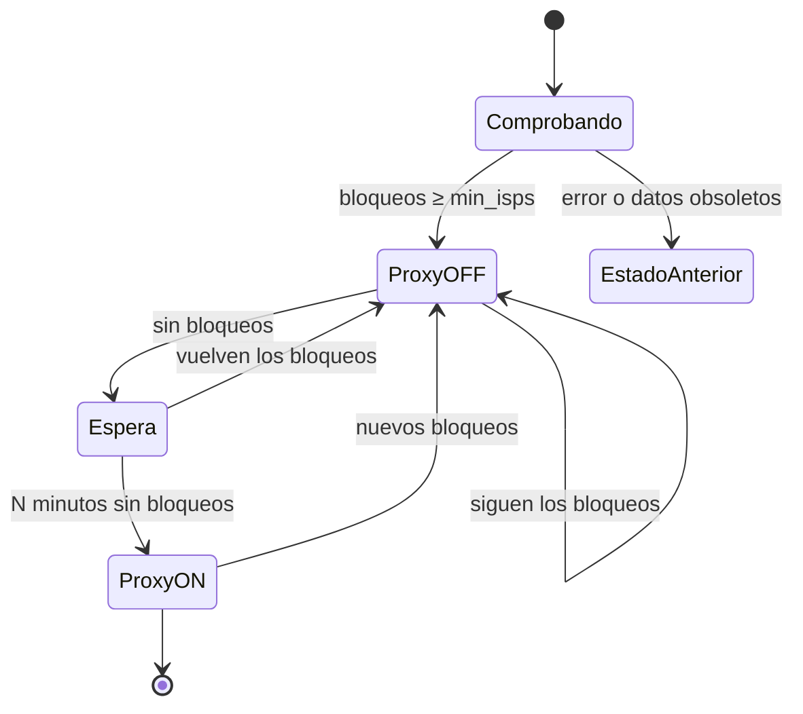

# laligagate

Servicio autónomo (sin dependencias) que desactiva el proxy de
Cloudflare mientras hay bloqueos de IP por fútbol en España y lo restaura
cuando terminan.

Consulta [hayahora.futbol](https://hayahora.futbol/) cada N minutos. Si hay
bloqueos activos, pone los registros DNS indicados en **DNS Only** (sin nube
naranja). Cuando cesan y pasa el periodo de espera, reactiva el proxy **solo en
los registros que apagó él**, con su TTL original; nunca activa un registro que
ya era DNS Only.

## Cómo funciona



- **Datos obsoletos**: si la fuente lleva más de `max_data_age_hours` sin
  actualizarse, se trata como error y no se cambia nada. Un fichero vacío de un
  generador parado no es un «no hay bloqueos».
- **Dos modos**: `global` (cualquier bloqueo en España, preventivo) y `own_ip`
  (solo si las IPs de Cloudflare que sirven estos registros aparecen en la
  lista, resueltas por DNS sobre HTTPS).
- **`min_isps`**: número de operadores distintos con bloqueo para actuar (1-5).
- **Override manual**: `proxy off` congela el automatismo; `proxy on` restaura
  al instante; `proxy auto` devuelve el control al servicio.
- **Concurrencia**: un `flock` impide que el demonio y un comando manual hagan
  cambios opuestos a la vez.

## Requisitos

- Linux con systemd y Python 3.8 o superior (solo biblioteca estándar).
- Token de API de Cloudflare con `Zona > DNS > Editar` y `Zona > Zona > Leer`
  (plantilla «Editar zona DNS»), limitado a la zona.
- El `zone_id` de Cloudflare (panel de la zona, sección API).

## Instalación

```bash
git clone <este-repo> laligagate
cd laligagate
sudo ./install.sh
sudo editor /etc/laligagate/config.json   # token, zone_id, registros
sudo laligagate test
sudo laligagate check --dry-run           # muestra la decisión sin tocar DNS
sudo systemctl enable --now laligagate
```

El script instala en `/opt/laligagate`, `/etc/laligagate` y la unidad systemd.
Si el fichero de configuración ya existe, no lo sobrescribe.

## Configuración (`/etc/laligagate/config.json`)

| Clave | Significado |
|---|---|
| `cloudflare.api_token` | Token con permiso de edición DNS en la zona |
| `cloudflare.zone_id` | ID de la zona |
| `cloudflare.zone_name` | Nombre de la zona (para `"@"`) |
| `records` | Nombres a gestionar; `[]` = todos los A/AAAA/CNAME |
| `detection.mode` | `global` o `own_ip` |
| `detection.min_isps` | Operadores con bloqueo necesarios (1-5) |
| `timing.interval_minutes` | Frecuencia de comprobación |
| `timing.restore_wait_minutes` | Espera antes de reactivar el proxy |
| `source.max_data_age_hours` | Antigüedad máxima aceptada de la fuente |

Tras editar la configuración: `systemctl restart laligagate`.

## Comandos

```bash
laligagate status            # estado guardado, sin llamadas de red
laligagate check --dry-run   # qué haría ahora, sin tocar Cloudflare
laligagate test              # credenciales, zona y registros gestionados
laligagate proxy off         # fuerza DNS Only y congela el automatismo
laligagate proxy on          # restaura el proxy ya
laligagate proxy auto        # vuelve al automatismo
journalctl -u laligagate -f
```

## Ficheros

- `/opt/laligagate/laligagate.py` - servicio
- `/etc/laligagate/config.json` - configuración (0600)
- `/var/lib/laligagate/state.json` - estado y registros apagados
- `/etc/systemd/system/laligagate.service`

## Tests

Simulación de la máquina de estados con Cloudflare y la fuente simuladas:

```bash
python3 tests/test_state_machine.py
```

## Aviso

Mientras el proxy está en DNS Only el dominio resuelve a la IP de origen y esa
resolución queda registrada en servicios de DNS pasivo. Es el precio de saltarse
el bloqueo: conviene proteger el origen con cortafuegos (por ejemplo, admitir
solo rangos de Cloudflare cuando el proxy vuelva).

Además, con un registro proxied Cloudflare fuerza TTL automático (300 s), así
que en cada transición puede haber hasta ~5 minutos en que los resolutores
sirvan la IP anterior.

## Desinstalar

```bash
systemctl disable --now laligagate
laligagate proxy on    # si el proxy quedó en DNS Only
rm -rf /opt/laligagate /etc/laligagate /var/lib/laligagate /usr/bin/laligagate
rm /etc/systemd/system/laligagate.service
systemctl daemon-reload
```

## Licencia

GPLv3 (ver `LICENSE`). La lógica de detección y conmutación está inspirada en
el plugin de WordPress [bypass-laligagate](https://github.com/fernandotellado/bypass-laligagate)
de Fernando Tellado (GPLv2+), reescrita como servicio autónomo.
