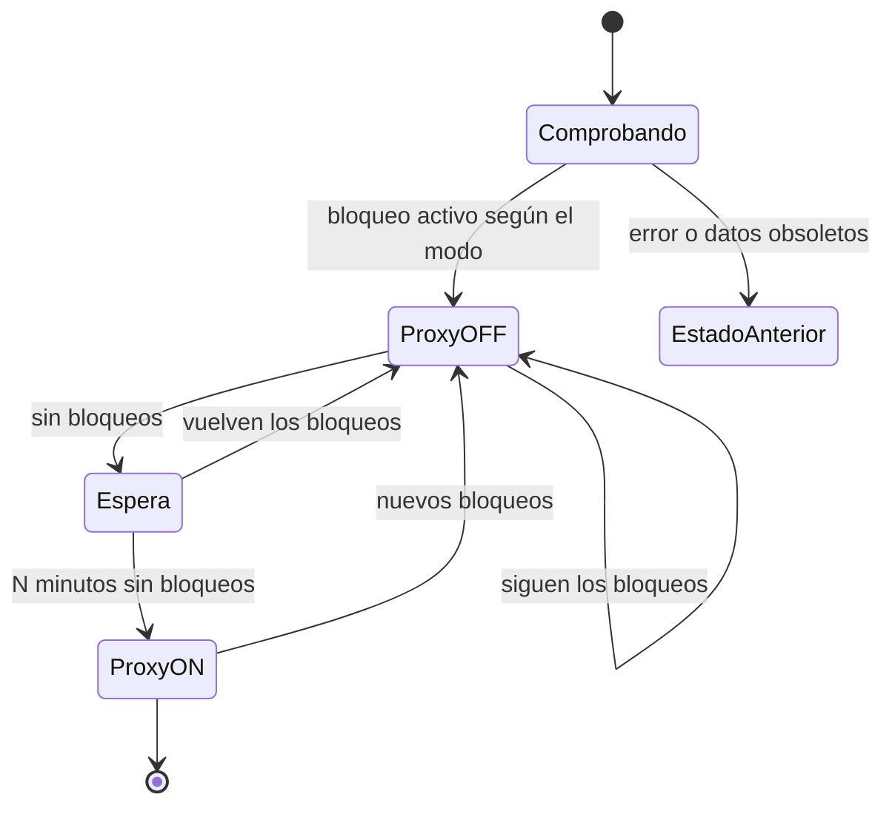

# laligagate

Servicio autónomo (sin dependencias) que desactiva el proxy de
Cloudflare mientras hay bloqueos de IP por fútbol en España y lo restaura
cuando terminan.

Consulta [hayahora.futbol](https://hayahora.futbol/) cada N minutos. Si hay
bloqueos activos, pone los registros DNS indicados en **DNS Only** (sin nube
naranja). Cuando cesan y pasa el periodo de espera, reactiva el proxy **solo en
los registros que apagó él**, con su TTL original; nunca activa un registro que
ya era DNS Only. Además, en cada transición ejecuta los *hooks* configurados,
útiles para conmutar otros servicios de la red (por ejemplo, el resolver DNS).

## Cómo funciona



- **Datos obsoletos**: si la fuente lleva más de `max_data_age_hours` sin
  actualizarse, se trata como error y no se cambia nada. Un fichero vacío de un
  generador parado no es un «no hay bloqueos».
- **Tres modos**: `web` (el mismo umbral que la portada de hayahora.futbol:
  actúa solo cuando esa portada diría «SÍ»), `global` (cualquier bloqueo en
  España, preventivo) y `own_ip` (solo si las IPs de Cloudflare que sirven estos
  registros aparecen en la lista, resueltas por DNS sobre HTTPS).
- **Modo `web`**: reproduce la regla exacta del frontend sobre
  `estado/data.json` — más de 10 IPs de Cloudflare bloqueadas a la vez por más
  de 2 operadores, o el par `188.114.96.5`/`188.114.97.5` bloqueado. Ignora
  `min_isps`; si `data.json` falla o está obsoleto no se toca nada.
- **`min_isps`**: número de operadores distintos con bloqueo para actuar (1-5).
  Solo aplica a `global` y `own_ip`.
- **Override manual**: `proxy off` congela el automatismo; `proxy on` restaura
  al instante; `proxy auto` devuelve el control al servicio.
- **Hooks**: al cambiar el estado de bloqueo se ejecutan comandos configurables
  (`hooks.on_blocked` / `hooks.on_clear`) en la misma pasada, sin esperar al
  siguiente intervalo. Sirven, por ejemplo, para conmutar el resolver DNS de la
  red mientras dura el bloqueo.
- **Concurrencia**: un `flock` impide que el demonio y un comando manual hagan
  cambios opuestos a la vez.

## Requisitos

- Linux con systemd y Python 3.8 o superior (solo biblioteca estándar).
- Token de API de Cloudflare con `Zona > DNS > Editar` y `Zona > Zona > Leer`
  (plantilla «Editar zona DNS»), limitado a la zona.
- El `zone_id` de Cloudflare (panel de la zona, sección API).

## Instalación

```bash
git clone <este-repo> laligagate
cd laligagate
sudo ./install.sh
sudo editor /etc/laligagate/config.json   # token, zone_id, registros
sudo laligagate test
sudo laligagate check --dry-run           # muestra la decisión sin tocar DNS
sudo systemctl enable --now laligagate
```

El script instala en `/opt/laligagate`, `/etc/laligagate` y la unidad systemd.
Si el fichero de configuración ya existe, no lo sobrescribe.

## Configuración (`/etc/laligagate/config.json`)

| Clave | Significado |
|---|---|
| `cloudflare.api_token` | Token con permiso de edición DNS en la zona |
| `cloudflare.zone_id` | ID de la zona |
| `cloudflare.zone_name` | Nombre de la zona (para `"@"`) |
| `records` | Nombres a gestionar; `[]` = todos los A/AAAA/CNAME |
| `detection.mode` | `web`, `global` o `own_ip` |
| `detection.min_isps` | Operadores con bloqueo necesarios (1-5); solo `global`/`own_ip` |
| `timing.interval_minutes` | Frecuencia de comprobación |
| `timing.restore_wait_minutes` | Espera antes de reactivar el proxy |
| `source.max_data_age_hours` | Antigüedad máxima aceptada de la fuente |
| `hooks.on_blocked` | Comando (lista de argumentos) al pasar a bloqueo |
| `hooks.on_clear` | Comando al cesar el bloqueo |
| `hooks.timeout_seconds` | Tiempo máximo por hook (30 por defecto) |

Tras editar la configuración: `systemctl restart laligagate`.

### Hooks de transición

Permiten reaccionar al cambio de estado sin sondear el fichero de estado. Se
ejecutan una sola vez por transición, **después** de aplicar los cambios DNS y
de persistir el estado, así que el comando puede leer `state.json` para saber
el estado real. Se lanzan sin shell, como lista de argumentos:

```json
"hooks": {
  "on_blocked": ["/usr/local/bin/mi-script", "bloqueo"],
  "on_clear": ["/usr/local/bin/mi-script", "libre"],
  "timeout_seconds": 30
}
```

Si un hook falla o expira, se registra el aviso y se reintenta en el siguiente
ciclo (el estado del hook no se actualiza). Un error de la fuente no dispara
hooks ni cambia el estado de bloqueo. `laligagate check --dry-run` muestra qué
hook ejecutaría sin lanzarlo.

Los hooks no reciben argumentos: si necesitan el detalle, leen
`/var/lib/laligagate/state.json`. Campos útiles: `blocked` (verdadero mientras
hay bloqueo), `hook_state` (último estado notificado), `proxy_off`,
`last_source` y `last_error`. Se guían por la detección, no por el override
manual.

#### Ejemplo: conmutar el resolver DNS de la red

Un uso típico es apuntar el DNS doméstico (AdGuard Home, Pi-hole, dnsmasq…) a
un resolver público que esquive los bloqueos indiscriminados solo mientras hay
fútbol, y volver al habitual después. El hook debe ser **idempotente**: si los
upstreams ya son los deseados, no debe hacer nada.

```python
# /usr/local/bin/dns-conmutar  (esquema, sin dependencias)
import json

estado = json.load(open("/var/lib/laligagate/state.json"))
if estado["blocked"]:
    nuevos = ["https://resolver-alternativo/dns-query"]
else:
    nuevos = ["https://resolver-habitual/dns-query"]
# 1. leer los upstreams actuales del DNS local (API o configuración)
# 2. si ya coinciden con `nuevos`, salir sin tocar nada
# 3. escribir `nuevos` y limpiar la caché DNS del resolver
```

```json
"hooks": {
  "on_blocked": ["/usr/local/bin/dns-conmutar"],
  "on_clear":   ["/usr/local/bin/dns-conmutar"]
}
```

Advertencias:

- Los bloqueos de LaLiga son **por IP**: un resolver alternativo solo ayuda si
  el servicio está detrás de una CDN con IPs alternativas no bloqueadas. No
  sirve para un origen único.
- La caché del resolver y la del sistema operativo o el navegador pueden
  mantener la respuesta anterior hasta que expire su TTL. Limpia la caché del
  resolver al conmutar.
- El DNS seguro (DoH) del navegador y los anuncios IPv6 del router pueden
  saltarse el resolver local.

## Comandos

```bash
laligagate status            # estado guardado, sin llamadas de red
laligagate check --dry-run   # qué haría ahora, sin tocar Cloudflare
laligagate test              # credenciales, zona y registros gestionados
laligagate proxy off         # fuerza DNS Only y congela el automatismo
laligagate proxy on          # restaura el proxy ya
laligagate proxy auto        # vuelve al automatismo
journalctl -u laligagate -f
```

## Ficheros

- `/opt/laligagate/laligagate.py` - servicio
- `/etc/laligagate/config.json` - configuración (0600)
- `/var/lib/laligagate/state.json` - estado y registros apagados
- `/etc/systemd/system/laligagate.service`

## Tests

Simulación de la máquina de estados con Cloudflare y la fuente simuladas:

```bash
python3 tests/test_state_machine.py
```

## Aviso

Mientras el proxy está en DNS Only el dominio resuelve a la IP de origen y esa
resolución queda registrada en servicios de DNS pasivo. Es el precio de saltarse
el bloqueo: conviene proteger el origen con cortafuegos (por ejemplo, admitir
solo rangos de Cloudflare cuando el proxy vuelva).

Además, con un registro proxied Cloudflare fuerza TTL automático (300 s), así
que en cada transición puede haber hasta ~5 minutos en que los resolutores
sirvan la IP anterior.

## Desinstalar

```bash
systemctl disable --now laligagate
laligagate proxy on    # si el proxy quedó en DNS Only
rm -rf /opt/laligagate /etc/laligagate /var/lib/laligagate /usr/bin/laligagate
rm /etc/systemd/system/laligagate.service
systemctl daemon-reload
```

## Licencia

GPLv3 (ver `LICENSE`). La lógica de detección y conmutación está inspirada en
el plugin de WordPress [bypass-laligagate](https://github.com/fernandotellado/bypass-laligagate)
de Fernando Tellado (GPLv2+), reescrita como servicio autónomo.
